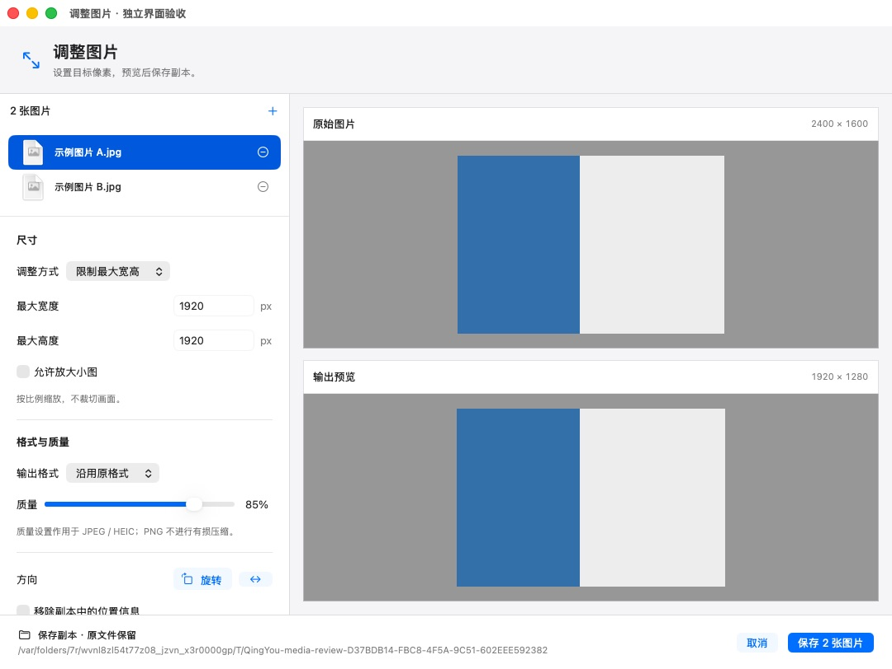
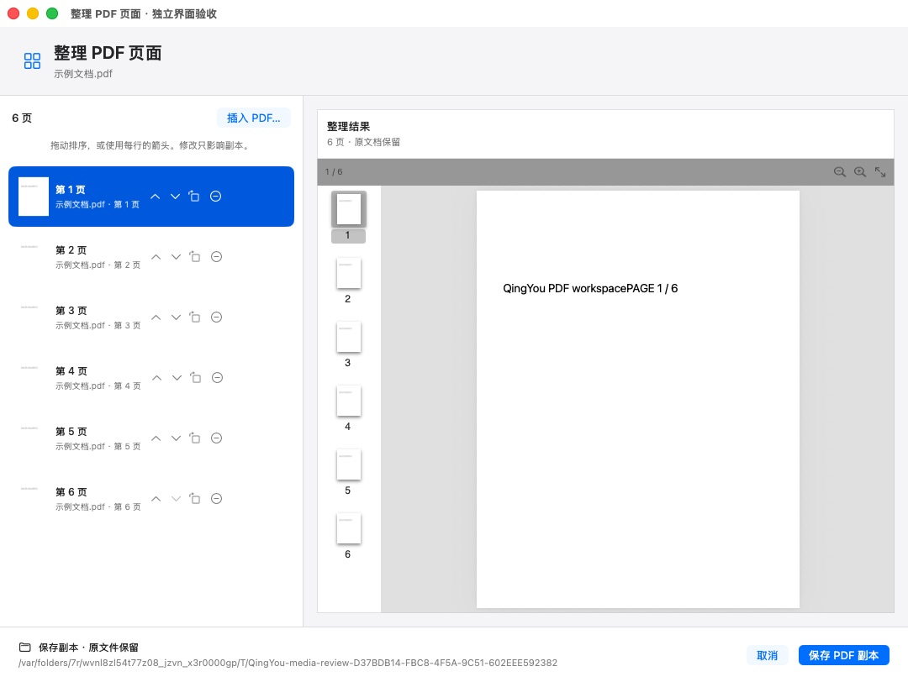
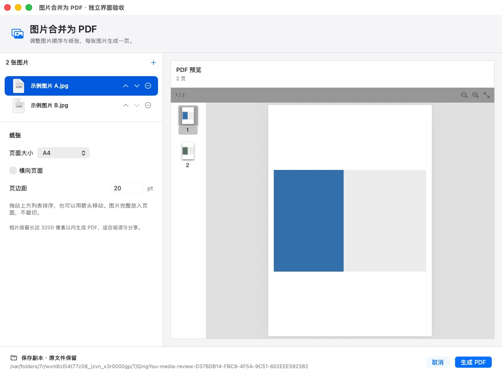
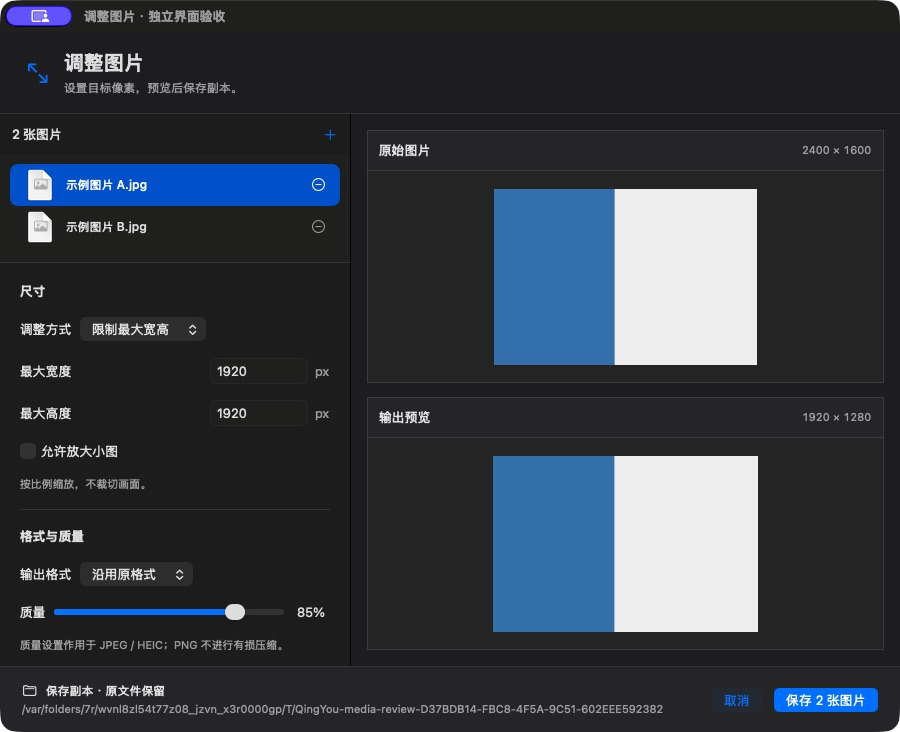
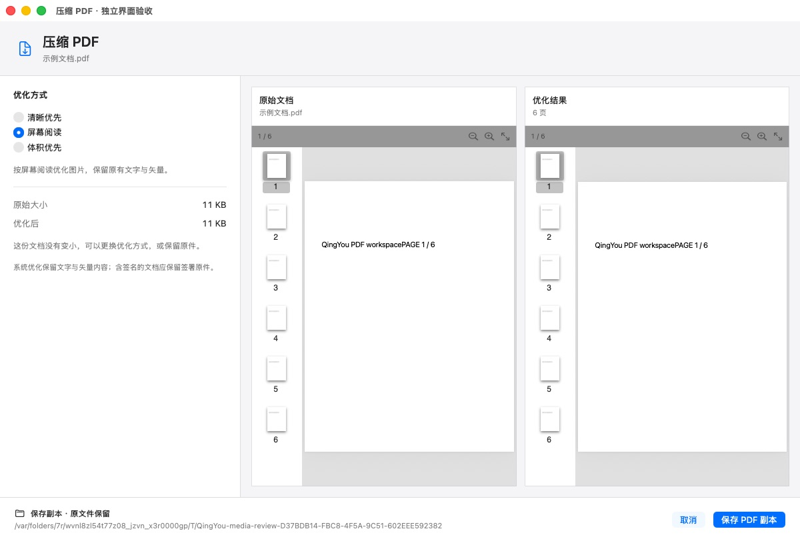

<a id="top"></a>

<p align="center">
  <picture>
    <source type="image/svg+xml" srcset="docs/assets/hero.svg">
    
  </picture>
</p>

<h1 align="center">轻右 · QingYou</h1>

<p align="center">
  <strong>把常用的文件操作，放回右键菜单。</strong><br>
  新建文档、调整图片、整理 PDF，从 Finder 就近完成。<br>
  <sub>A native macOS Finder utility. Built with Swift, SwiftUI and AppKit.</sub>
</p>

<p align="center">
  
  
  
  
</p>

<p align="center">
  <a href="#features">功能</a> ·
  <a href="#images">图片</a> ·
  <a href="#pdf">PDF</a> ·
  <a href="#clipboard">粘贴为文件</a> ·
  <a href="#start">开始使用</a> ·
  <a href="#build">源码构建</a> ·
  <a href="#faq">常见问题</a>
</p>

<p align="center">
  <strong>0.2.1 预览</strong> · 2026-10-28<br>
  <sub>免费使用 · MIT 开源 · 无需账号 · 本机处理</sub>
</p>

<div align="center">
  <table align="center">
    <tr>
      <td align="center" width="200"><h3>9 类</h3><sub>右键功能</sub></td>
      <td align="center" width="200"><h3>13 种</h3><sub>文件模板</sub></td>
      <td align="center" width="200"><h3>12 项</h3><sub>媒体工具</sub></td>
      <td align="center" width="200"><h3>98 项</h3><sub>检查通过</sub></td>
    </tr>
  </table>
</div>

## ✨ 关于轻右

轻右是一款原生 macOS Finder 效率工具。新建一份演示文稿、把图片调整到指定像素、从 PDF 中取出几页，都可以从当前目录的右键菜单开始。

- **就在手边**：常用操作直接展示在右键菜单，图片与 PDF 任务打开独立窗口。
- **操作自然**：先创建“未命名”文件，再用 Finder 改名；拷贝路径静默完成。
- **先看再保存**：核对图片尺寸、PDF 页面和输出顺序，处理结果另存，保留原件。
- **文件留在本机**：使用系统框架处理文件，无需账号，没有广告或遥测。

## 🖼️ 界面预览

<p align="center">
  
  <br><sub>调整图片 · 尺寸、比例与输出预览放在一起</sub>
</p>

<table align="center">
  <tr>
    <td align="center" width="50%">
      <a href="docs/assets/current-pdf-organize.png"></a><br>
      <strong>整理 PDF 页面</strong><br><sub>核对顺序、旋转与删除结果</sub>
    </td>
    <td align="center" width="50%">
      <a href="docs/assets/current-images-pdf.png"></a><br>
      <strong>图片合并为 PDF</strong><br><sub>选择纸张、边距，逐页查看</sub>
    </td>
  </tr>
</table>

<details>
<summary>更多预览：深色外观与 PDF 压缩</summary>

<p align="center">
  <br>
  <sub>跟随系统外观，支持紧凑窗口</sub>
</p>

<p align="center">
  <br>
  <sub>显示实际压缩结果；文件体积不保证更小</sub>
</p>

</details>

<sub>以上为加载当前界面与模型代码的隔离验收应用截图，使用自制示例文件。真实 Finder 与安装验收见<a href="docs/VERIFICATION.md">验证记录</a>；封面为品牌插画。<a href="docs/assets/README.md">素材来源</a>。</sub>

<a id="start"></a>

## 🚀 开始使用

### 安装与启用

**下载 0.2.1 预览版**：包含 Apple Silicon 与 Intel 两种架构，推荐选择 DMG。

<p align="center">
  <a href="https://github.com/oiiizhou/QingYou/releases/download/preview-0.2.1/QingYou-0.2.1.dmg"><strong>下载 DMG</strong></a> ·
  <a href="https://github.com/oiiizhou/QingYou/releases/download/preview-0.2.1/QingYou-0.2.1.zip">ZIP 备用包</a> ·
  <a href="https://github.com/oiiizhou/QingYou/releases/tag/preview-0.2.1">更新说明与校验值</a>
</p>

1. 打开 DMG，将 **QingYou.app** 拖入「应用程序」。
2. 启动轻右，点击首页 **“管理扩展”**，按系统引导开启轻右 Finder 扩展。
3. 返回 Finder，在文件、文件夹或空白处右击，使用需要的功能。

<sub>“Code → Download ZIP”及 Release 中的“Source code”是源码，不是安装包。当前测试包使用 ad-hoc 签名，尚未完成 Developer ID 签名与 Apple 公证，首次打开可能出现系统来源检查；见<a href="#faq">常见问题</a>。</sub>

| 运行环境 | 支持情况 |
| :--- | :--- |
| macOS | 13 及以上；PDF 压缩需要 13.4 及以上 |
| Apple Silicon 与 Intel | 已构建双架构测试包；目前实机验收为 Apple Silicon / macOS 26.3，Intel 待测 |
| 运行依赖 | 系统框架，无需额外第三方运行时 |

### 调成自己的习惯

| 设置位置 | 可调整的内容 |
| :--- | :--- |
| 右键菜单 | 功能开关、顺序、收纳方式；日常精简／图文工作／全部功能预设 |
| 文件模板 | 模板名称、启用状态、自定义模板与 WPS 打开偏好 |
| 通用设置 | 登录启动、新建后打开或编辑名称、重名策略与反馈 |

常用操作默认直接显示，图片与 PDF 功能分别收纳到“图片处理”和“PDF 处理”二级菜单；也可把全部入口收纳到“轻右”子菜单。生效范围默认为用户主目录与 `/Volumes`，包含子目录；未启用扩展时，工具箱仍可独立使用。

首次运行默认申请登录启动，只申请一次；手动关闭后不再自动开启。登录启动驻留菜单栏，普通打开显示主窗口。

右键任务及图片、PDF 工具窗口以后台辅助应用身份运行，不额外显示 Dock 图标。主动打开轻右主窗口时显示 Dock 图标，关闭主窗口后继续驻留菜单栏。

<details>
<summary>常用快捷键</summary>

| 快捷键 | 行为 |
| :---: | :--- |
| **⌘W** | 关闭当前窗口，保留其他窗口与菜单栏驻留 |
| **⌘Q** | 退出轻右 |
| **⌘,** | 打开轻右设置 |
| **Return** | Finder 中编辑所选文件名；任务窗口中执行可用的默认操作 |
| **Esc** | 新任务窗口中取消或请求取消处理 |

</details>

<a id="features"></a>

## 🧰 功能一览

| 场景 | 可以做什么 |
| :--- | :--- |
| **新建文档** | 13 种内置格式、自定义模板、WPS 打开偏好；重名自动编号 |
| **文件整理** | 剪切粘贴、拷贝到、移动到；同名保留两份或跳过，支持最近一批移动的撤销 |
| **路径与终端** | 多选路径逐行拷贝；通过系统服务在当前目录打开 Terminal |
| **粘贴为文件** | 剪贴板文字存为 TXT／Markdown，图片存为 PNG |
| **图片处理** | 尺寸、比例、格式、质量、旋转、翻转、图片信息与去除位置 |
| **图片转 PDF** | 多图排序、纸张、方向、边距与逐页预览 |
| **PDF 工作台** | 合并、按范围拆分、压缩、整理页面、导出图片与文字、本机 OCR |
| **日常管理** | 隐藏属性、文件夹图标与恢复默认图标、最近 100 条本地操作记录及结果定位 |

<details>
<summary><strong>13 种内置文件模板</strong> · 含 Word、Excel、PowerPoint</summary>

| 类型 | 格式 |
| :--- | :--- |
| 文本与笔记 | `.txt` · `.md` |
| 文字文档 | `.doc` · `.docx` |
| 电子表格 | `.xls` · `.xlsx` · `.csv` |
| 演示文稿 | `.ppt` · `.pptx` |
| 代码与配置 | `.py` · `.json` · `.yaml` · `.sh` |

六种 Office 模板是真实的文档格式，随源码提供；日常构建不依赖 Office 或 WPS。检测到 WPS 时，默认优先用它打开新建办公文档，仅设置当前文件的打开关联。

右键新建演示文稿会直接得到 `未命名.pptx`；重名时为 `未命名 2.pptx`。授权辅助功能后，会尝试直接进入 Finder 的名称编辑；0.2.1 已实测 TXT 与 PPTX。未授权或无法确认所选文件时保留选中状态，按 **Return** 即可改名。

自定义模板支持启用、排序和命名；文字模板支持 `{{name}}`、`{{date}}` 占位符。

</details>

<a id="images"></a>

## 🎨 图片处理

在 Finder 右键选择 **“图片处理 → 调整图片…”**，选中的图片会直接带入；没有适用选区时，通过系统文件选择器添加。多张图片可以使用同一套参数批量处理。

### 尺寸与格式

| 调整方式 | 示例与行为 |
| :--- | :--- |
| 限制最大宽高 | 不超过 `1920 × 1080`，按比例缩小到范围内，不裁切 |
| 按百分比 | 调整为原图的 `50%` 等指定比例 |
| 自定义像素 | 锁定比例时宽高联动；解锁后独立设置宽高，可能改变图片形状 |

默认不放大小图。可选择 PNG／JPEG／HEIC、调整有损质量、旋转、水平翻转，或去除副本中的位置。PNG 保留透明通道，JPEG 使用白色背景处理透明区域。

### 图片信息

查看文件创建／修改时间、EXIF 拍摄时间、像素、大小、色彩、相机、镜头、曝光与文件中的位置字段。缺失的地点、时区不做推测；点击地图按钮才会打开地图。

去除位置会另存重编码副本，保留原件及无关的作者／版权字段。

### 图片合并为 PDF

添加多张图片，通过上下箭头调整顺序，选择 A4、US Letter 或随图片尺寸，以及横竖方向与边距。逐页预览后生成 `图片合并.pdf`。

<details>
<summary>格式与输出说明</summary>

- **沿用原格式**支持 PNG、JPEG、HEIC、TIFF；其他源格式会在确认前要求选择输出格式。
- **动态或多页图片**在调整与图片合成工作台中需要先导出为单张。
- **图片合成 PDF**按最长边 3200 像素以内处理，适合阅读与分享；原始分辨率印刷归档需另行处理。
- **顺序调整**请先使用已验证的上下箭头，新列表拖动尚未通过桌面实测。

</details>

<a id="pdf"></a>

## 📄 PDF 工作台

在 Finder 右键展开 **“PDF 处理”**，即可选择合并、拆分、压缩、整理页面、导出图片或提取文字。六项工具都在第二层，无需再展开“导出 PDF”。空白处也有分类入口，可以随后选择文件。

| 工具 | 主要能力 | 默认结果 |
| :--- | :--- | :--- |
| 合并 PDF | 多份文件排序，原文与合并结果并排查看 | `合并PDF.pdf` |
| 拆分 PDF | 按多组页码范围拆分，每份结果可单独命名 | 原名＋页码 |
| 压缩 PDF | 三种系统图片优化组合、实际体积对比 | `原名-压缩.pdf` |
| 整理页面 | 重排、旋转、删除、插入其他 PDF 的页面 | `原名-整理.pdf` |
| 导出为图片 | PNG／JPEG、72／144／300 DPI | `原名-页面图片/` |
| 提取文字 | 提取已有文字，可识别无文字层页面 | `原名-文字.txt` |

### 按需要的页码拆分

每一行对应一份输出，可以填写范围和可选名称。

| 输入 | 得到的文件 |
| :---: | :--- |
| `1-3` | 包含第 1 至 3 页的一份 PDF |
| `1-3,5` | 包含第 1 至 3 页和第 5 页的一份 PDF |
| 再添加一行 `4-6` | 额外生成包含第 4 至 6 页的另一份 PDF |

范围输入与预览联动。越界、重复或无效输入会就地说明，并禁用导出。图片与文字导出也支持 `3,1` 等指定顺序；页面图片用 `0001-原第3页.png` 的名称记录导出顺序及原页码。

### 保存到哪里？

结果保存在右键所在目录；从工具箱启动时，默认保存到第一份所选文件所在目录。同名自动编号，原件保留。新工具窗口支持进度、取消与先暂存后提交，失败或取消时回滚本次输出。

<details>
<summary>压缩、OCR 与文档兼容性</summary>

- **压缩**使用 macOS 13.4+ 的 PDFKit 图片优化，保留文字与矢量；体积不保证更小，窗口显示实际结果。
- **OCR**在本机执行，复杂排版、表格与手写内容需要校对。
- **PDF 重写**不保证保留原书签、交互表单或数字签名，签署文档请保留原件；锁定或损坏文件会说明错误。
- **页面顺序**建议先通过上下箭头调整；拖动的验证范围见[已知限制](#limits)。

</details>

<a id="clipboard"></a>

## 📋 粘贴为文件

复制一段文字或一张截图，在目标文件夹右键，就能把它保存成文件。**⌘V 用于粘贴已复制的文件；“粘贴为文件”将剪贴板内容生成新文件。**

| 剪贴板内容 | 操作 | 生成结果 |
| :--- | :--- | :--- |
| 网页、聊天或编辑器中复制的文字 | 粘贴为文件 | `未命名.txt`，UTF-8 |
| 复制的截图或图片 | 粘贴为文件 | `未命名.png` |
| Markdown 文字 | 按住 **⌥**，选择“粘贴为 Markdown” | `未命名.md` |
| Finder 中已复制的文件 | 系统 **⌘V** 或“粘贴文件到此处” | 直接粘贴文件，不重复转换 |

没有可用内容时入口禁用。文件在当前目录创建，同名自动编号，不清空剪贴板，也不显示成功弹窗。

<a id="permissions"></a>

## 🔒 隐私与权限

文件转换、PDF 处理与文字识别在本机完成。主动点击地图、帮助或仓库链接时，会打开对应的外部应用或页面。

| 权限／系统集成 | 用途 |
| :--- | :--- |
| Finder 扩展 | 将功能加入右键菜单 |
| 文稿、桌面等文件夹访问 | 处理你选择的文件，由 macOS 按需询问 |
| 辅助功能，可选 | 尝试自动进入 Finder 名称编辑 |
| 登录项 | 根据偏好登录启动 |

<details>
<summary>名称编辑、配置与本地记录</summary>

自动名称编辑只在 Finder 前台、单选及完整路径与新文件匹配时尝试；不能确认则保留选中，按 **Return** 改名。本地开发签名可能随构建变化，更新后系统可能重新确认文件夹或辅助功能权限。

设置、自定义模板与最近操作记录保存在：

```text
~/Library/Application Support/QingYou/
├── settings.json
├── history.json
└── Templates/
```

历史记录可能包含文件名与路径，仅存于本机。报告问题前请移除个人信息。

</details>

<a id="build"></a>

## 🛠️ 从源码构建

需要 **Xcode Command Line Tools 或完整 Xcode**。

将终端切换到本 README 所在的工程目录，执行：

```bash
# 在 QingYou 工程目录执行
bash scripts/build.sh

# 从菜单栏退出正在运行的轻右后安装
bash scripts/install.sh
```

生成 `build/QingYou.app`，安装到 `~/Applications/QingYou.app`。脚本默认按本机架构构建；日常构建无需 Python 第三方包、Office 或 WPS。当前验证使用 Swift 6.2.3，以 Swift 5 语言模式编译。

<details>
<summary>测试、模板校验与双架构构建</summary>

```bash
bash scripts/test.sh
python3 scripts/verify_project.py
python3 scripts/verify_templates.py
python3 scripts/verify_docs.py

# Apple Silicon + Intel；构建成功不等于完成 Intel 实机验证
ARCHS="arm64 x86_64" bash scripts/build.sh
```

应用使用系统 AppKit、SwiftUI、FinderSync、PDFKit、ImageIO 和 Vision。重新生成办公模板的开发依赖见[架构说明](docs/ARCHITECTURE.md)。

</details>

<details>
<summary>工程结构</summary>

```text
QingYou/
├── Sources/
│   ├── Core/             配置、请求、文件与 PDF 基础操作
│   ├── App/              原生界面、任务调度与媒体工作台
│   └── FinderExtension/  右键菜单与请求投递
├── Resources/            图标、权限声明与办公模板
├── Tests/                临时目录与独立剪贴板中的测试
├── scripts/              构建、安装、校验、同步与打包
├── docs/                 说明、架构、验证与截图
├── .github/              构建与预览版发布工作流
├── CONTRIBUTING.md
├── README.md
└── LICENSE
```

Finder 扩展负责菜单与请求，耗时任务由主程序执行。新工作台具有独立后台队列、预览代次与取消令牌，不在 Finder 进程内转换文件。

</details>

<a id="verification"></a>

## ✅ 验证与版本状态

**0.2.1 是预览版。** 2026-10-28 在 Apple Silicon / macOS 26.3 重新通过 98 项自动化检查。下表汇总本轮与此前的实机记录；其他设备的覆盖范围见已知限制。云端结果请查看 [GitHub Actions](https://github.com/oiiizhou/QingYou/actions)。

| 自动化检查 | 数量 |
| :--- | ---: |
| 核心与媒体处理 | 57 |
| 应用集成 | 24 |
| 新工作台 | 17 |
| **合计** | **98 项通过** |

<details>
<summary>已完成的本地验收</summary>

| 项目 | 验收内容 |
| :--- | :--- |
| Office 模板 | 六种格式的 OOXML／复合二进制结构校验 |
| 图片导出 | 2400 × 1600 → 1200 × 800，重新读取像素正确 |
| PDF 输出 | 两图 B→A 合成、页面重排／删除／旋转、压缩后页数与文字保持 |
| 范围导出 | `3,1` 的文件名、144 DPI 图片、TXT 顺序正确 |
| 扫描页 OCR | 无文字层的自制英文扫描 PDF 成功识别，不代表复杂文档准确率 |
| 原生交互 | 明暗与紧凑窗口、错误输入、真实 Finder 入口、后台工具窗口 ⌘W、授权后自动改名 |
| 后台与升级 | 右键任务保持后台身份，主窗口关闭后回到后台；升级后扩展持续运行 |
| 安装与打包 | DMG 只读挂载、ZIP 解压、双架构、严格签名与 SHA-256；程序逐文件匹配 |

</details>

<a id="limits"></a>

### 已知限制

- **交互**：新图片／页面列表拖动仍需更多桌面验证，请先用上下箭头。自动改名依赖可选的辅助功能权限；开发签名更新后可能需要重新授权，未授权时可按 **Return**。原有 PDF 合并列表有独立的历史拖动验证记录。
- **设备覆盖**：Intel、较早 macOS、外接盘、网络盘、大文件、多显示器与完整辅助功能组合仍需补测；终端服务的权限提示与不同系统语言也需更多设备验证。
- **分发**：尚无 Developer ID 签名、Apple 公证及另一台 Mac 的完整下载安装验证。
- **格式边界**：PDF 重写可能影响书签、表单或签名；调整与合成工作台拒绝多帧图片，旧的一键 PNG／JPEG 转换仅处理首帧且不保留全部元数据。

[完整验证记录](docs/VERIFICATION.md) · [版本更新记录](docs/RELEASE_NOTES.md)

<a id="faq"></a>

## 💬 常见问题

<details>
<summary><strong>GitHub 下载的 ZIP 为什么不能直接安装？</strong></summary>

“Code → Download ZIP”和 Release 的“Source code”是源码，需要先构建。普通用户请在 [Releases](https://github.com/oiiizhou/QingYou/releases) 的 Assets 中选择项目发布的 DMG；0.2.1 对应 `QingYou-0.2.1.dmg` 或 `QingYou-0.2.1.zip`，均包含双架构应用。

</details>

<details>
<summary><strong>右键没有轻右的功能？</strong></summary>

在首页确认扩展状态，检查“右键菜单”的功能开关、通用设置中的生效目录。重新打开 Finder 窗口，再刷新扩展状态；同时检查同类扩展是否造成重复菜单。PDF 与图片工作台在空白处也有入口，会随后选择文件。

</details>

<details>
<summary><strong>为什么读取文稿里的文件一直等待？</strong></summary>

检查 macOS 是否正在等待文件夹访问确认。开发版更新可能改变本地签名，系统会重新判断授权。本地已观察到允许文稿访问后恢复读取与导出；按自己的文件访问需求决定是否授权。这与可选的辅助功能权限不同。

</details>

<details>
<summary><strong>终端服务暂不可用怎么办？</strong></summary>

在系统设置“键盘 → 键盘快捷键 → 服务”中检查“新建位于文件夹位置的终端窗口”。系统语言和版本可能影响名称，当前入口调用 Terminal 的系统服务，提示行为仍待更多实机覆盖。

</details>

<details>
<summary><strong>撤销和取消会恢复什么？</strong></summary>

撤销用于本次启动内最近一批移动，执行前会核对文件身份及原位置。图片／PDF 另存副本，不纳入移动撤销。新工具窗口的取消会请求停止后台任务，并回滚本次尚未完成的输出；已导出完成的结果由你自行保留或移除。

</details>

<details>
<summary><strong>macOS 提示无法验证开发者？</strong></summary>

当前测试构建没有 Developer ID 签名或 Apple 公证。从互联网下载时，macOS 会检查程序来源。先核对来源及发布说明，再参阅 [Apple 的安全打开 App 文档](https://support.apple.com/zh-cn/102445)。

</details>

<details>
<summary><strong>如何卸载？</strong></summary>

退出轻右后将应用移到废纸篓，或在工程目录执行 `bash scripts/uninstall.sh`。卸载脚本保留设置、自定义模板、操作记录和工作文件；清理本地配置前请自行备份。

</details>

## 🤝 参与改进

欢迎提交可复现的问题、改善文档或发起 Pull Request。

[问题反馈](https://github.com/oiiizhou/QingYou/issues) · [贡献指南](CONTRIBUTING.md) · [架构说明](docs/ARCHITECTURE.md) · [设计系统](DESIGN.md) · [工具窗口设计](docs/MEDIA_WORKSPACES.md)

维护者发布安装包的步骤见 [GitHub 发布指南](docs/RELEASING.md)。

## 📜 开源许可

源码采用 [MIT License](LICENSE)。轻右为独立实现，未包含其他右键工具的二进制程序、图标或模板资源。品牌图标、展示插画与自制截图的来源见[视觉资源说明](docs/assets/README.md)。

---

<p align="center">
  <strong>轻右 QingYou</strong><br>
  <sub>文件留在本机，操作就在手边。</sub><br><br>
  <a href="#top">返回顶部 ↑</a>
</p>
